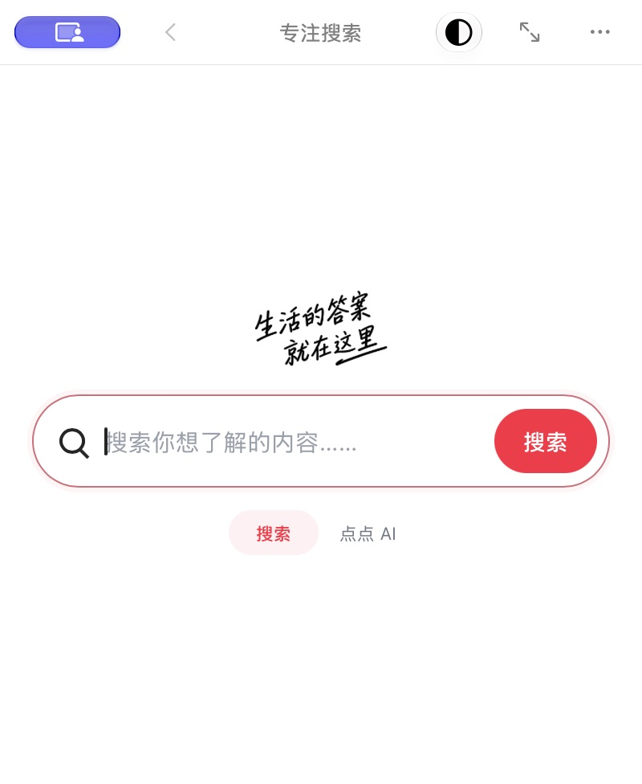
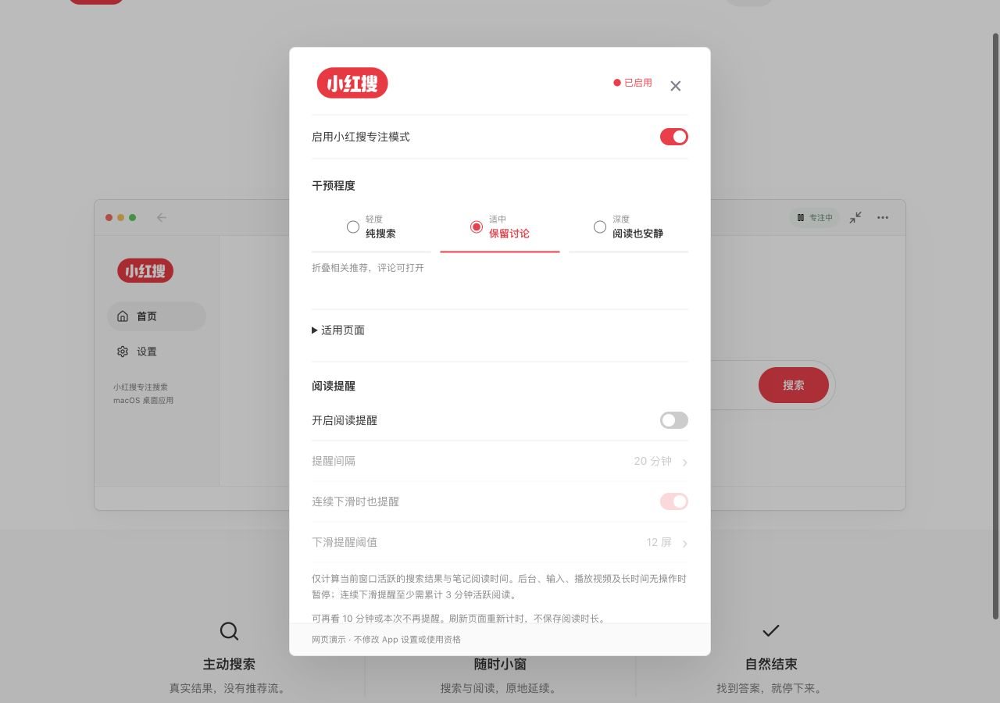

<h1 align="center">小红搜。</h1>

<strong>让搜索更专注。</strong>

搜索一个问题，阅读真实笔记，找到答案就停下来。

  <a href="https://github.com/zjyart/xiaohongsou/releases/latest"><strong>下载 Mac 版</strong></a> ·
  <a href="https://zhaojunyu.com/apps/xiaohongsou/">官网</a> ·
  <a href="https://zhaojunyu.com/apps/xiaohongsou/docs/">使用文档</a> ·
  <a href="docs/faq.md">常见问题</a>

> **邀请码内测中。** 支持 Apple Silicon、macOS 13+。安装包不包含使用资格，需要获批设备及对应邀请码。当前版本尚未取得 Developer ID 签名与 Apple 公证；遇到系统或浏览器安全警告，请停止安装并联系开发者。

## 只为这一次搜索

小窗首页示意。实际界面以当前发行版为准。

| 想做的事 | 小红搜的方式 |
| --- | --- |
| 带着问题搜索 | 聚焦搜索首页，沿用小红书真实结果、排序与筛选。 |
| 占用更少空间 | 标准窗口与小窗切换，同一网页延续搜索和阅读。 |
| 决定干预程度 | 轻度、适中、深度三档，阅读提醒默认关闭。 |
| 自然结束 | 结束本次搜索回到首页，不退出账号、不删除历史。 |
| 少一点更新打扰 | 0.9.0 起后台下载和校验，正常退出后静默安装。 |

## 你的节奏，你来定

上图为官网设置演示，不包含真实账号或授权资料。App 内通过顶栏、侧栏或 `Command + ,` 打开同一个设置窗口。

## 下载与开始使用

1. 在 [Releases](https://github.com/zjyart/xiaohongsou/releases/latest) 下载名称带 `arm64-invite.zip` 的安装包，**不是** `Source code` 归档。
2. 使用同页的 `.sha256.txt` 核对文件完整性。完整性校验不等于病毒检测或 Apple 公证。
3. 解压后，在 App 复制设备编号，由内测提供者批准并绑定邀请码。
4. 点击“验证使用资格”，在系统浏览器完成邀请码验证，再返回 App。

默认首次启用后连续 72 小时，延期、换绑与撤回由管理员管理。需要小红书登录时，在 App 内单独完成；产品授权与小红书账号无关。

[安装指南](docs/getting-started.md) · [版本记录](CHANGELOG.md) · [官网备用下载](https://zhaojunyu.com/apps/xiaohongsou/download/?source=site)

## 隐私与边界

- 当前版不访问钥匙串，不读取系统浏览器 Cookie，App 授权会话只保留在内存。
- 授权服务接收匿名设备摘要、授权编号和验证时间，不接收小红书搜索词、笔记内容或 Cookie。
- 一个邀请码对应一台获批电脑。此限制不能保证抵抗二进制修改或硬件身份伪造。
- 小红搜是独立开发的**非官方** macOS 应用，与小红书不存在官方隶属、合作或背书关系。

## 关于这个仓库

这是**闭源软件的公开发行仓库**，仅包含产品图文、使用文档和发行记录。安装包单独附在 Releases；程序源码、构建工程、授权后台、邀请码和设备数据库均不公开。

GitHub 自动生成的 `Source code (zip / tar.gz)` 只归档本仓库的公开资料，不包含可编译的 App 源码。[GitHub 发行归档说明](https://docs.github.com/en/repositories/releasing-projects-on-github/about-releases)

Copyright (c) 2026 Junyu ZHAO. All rights reserved. [版权说明](NOTICE.txt)

普通问题可提交 [Issue](https://github.com/zjyart/xiaohongsou/issues/new/choose)。安全与授权问题请私下联系 [zjyart@gmail.com](mailto:zjyart@gmail.com)，不要公开邀请码、设备编号、令牌或登录数据。
