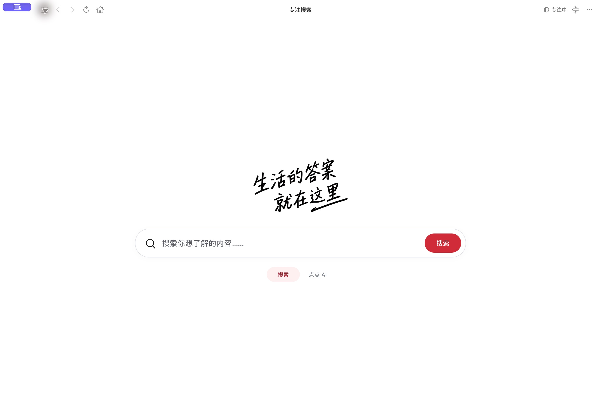
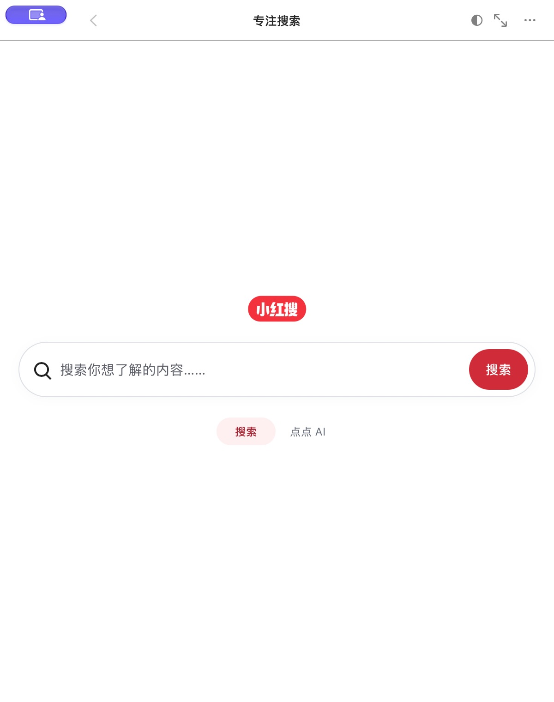
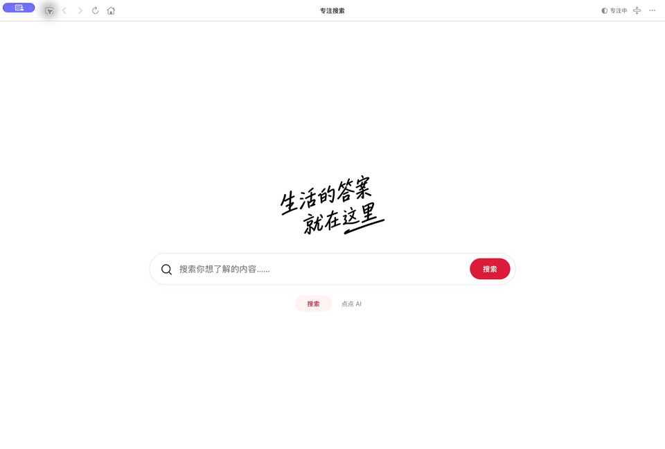
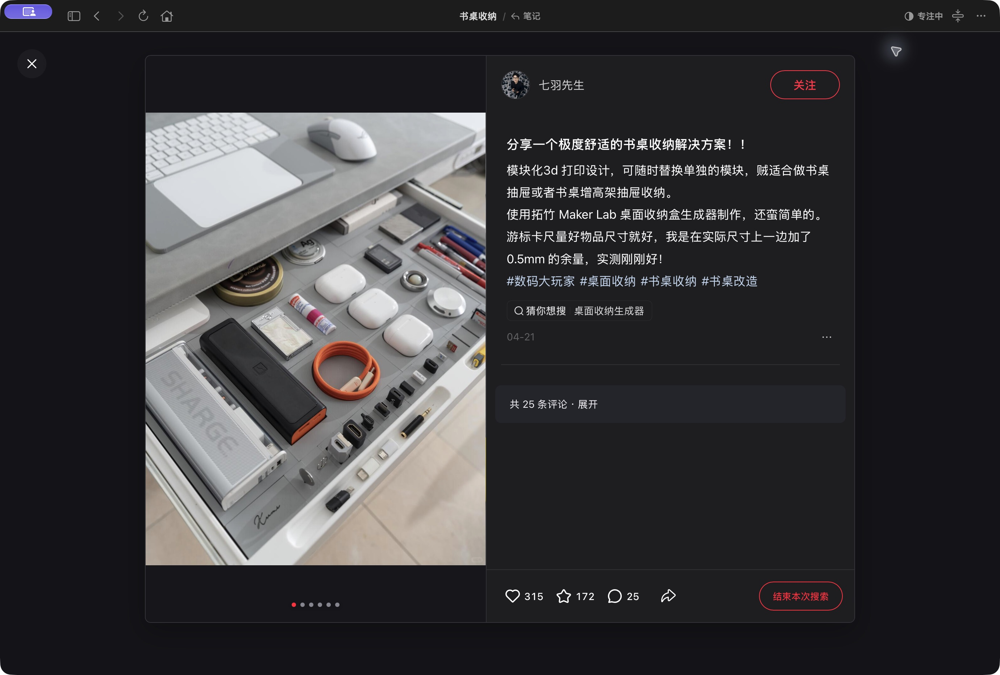
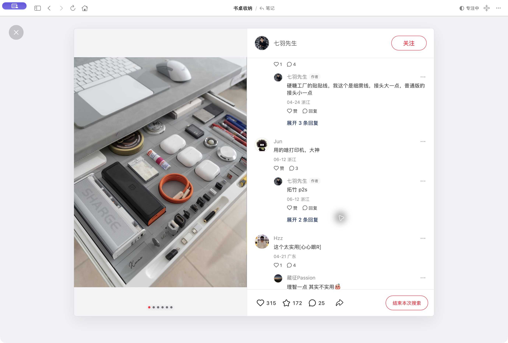
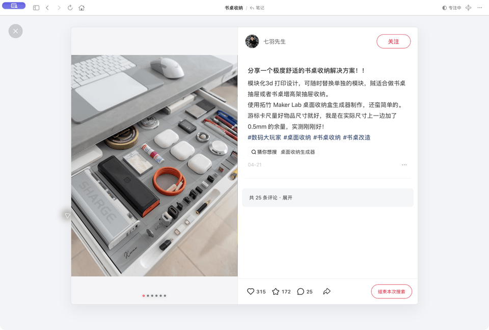
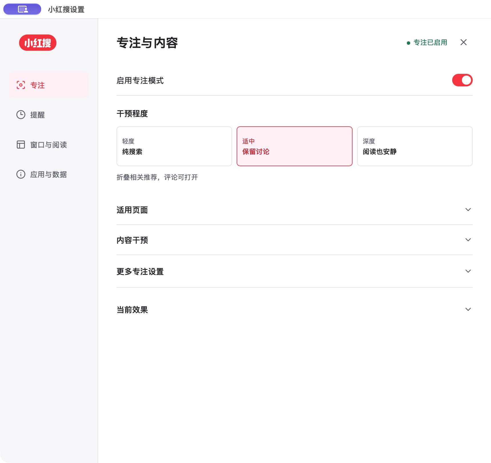
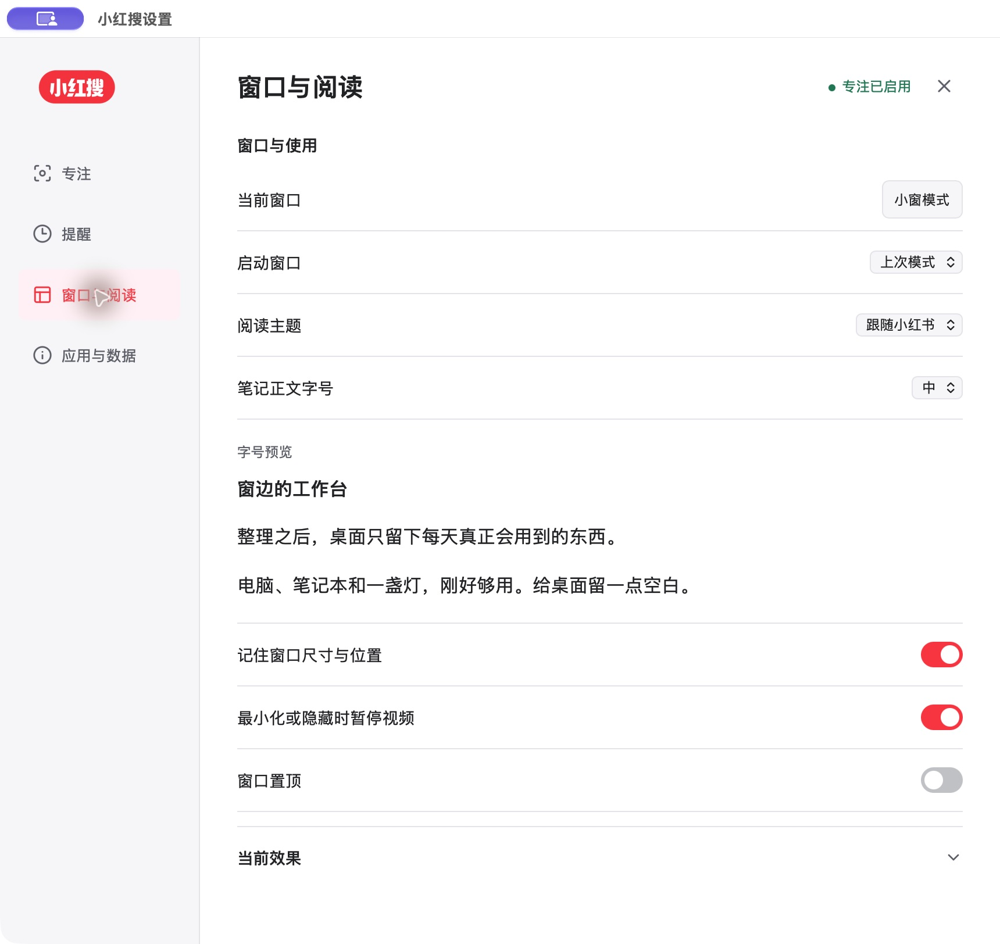

<h1 align="center">小红搜。</h1>

<strong>让搜索更专注。</strong>

在小红书里找答案，把注意力留给眼前的问题。

<a href="https://github.com/zjyart/xiaohongsou/releases/tag/v0.14.4.261028"><strong>下载 Mac 公开版</strong></a> · <a href="https://zhaojunyu.com/apps/xiaohongsou/">官网</a> · <a href="docs/getting-started.md">开始使用</a>

Apple 芯片 Mac · macOS 13+

> **公开测试版 0.14.4。** 当前尚未取得 Developer ID 签名与 Apple 公证，可能受系统安全限制。遇到系统或浏览器安全警告，请停止安装并联系开发者。

小红搜是一款 Mac 上的专注搜索工具。它保留小红书真实的搜索结果和笔记，将推荐首页与分散注意力的入口收起。

你可以用一扇小窗查资料，也可以展开窗口认真阅读。找到需要的内容后，点击“结束本次搜索”，回到简洁首页，继续自己的工作。

## 一扇小窗，够用了

查资料时少占一些屏幕，展开后继续原来的阅读。标准窗口与小窗共用一个网页，切换不重新登录，也不重新开始搜索。

## 熟悉的结果，少一些干扰

内容来自小红书。排序与筛选沿用原站，图文、视频和作者资料仍是真实页面。打开笔记之后，当前关键词留在顶栏，随时可以修改或回到这次搜索。

## 舒服地读完一篇笔记

<table><tr><td width="50%"></td><td width="50%"></td></tr></table>

按环境选择浅色、深色或跟随小红书。正文大小可以调整，图片和视频保留原站操作。

### 评论，想看时再打开

阅读正文时，下滑不会自动展开评论。需要了解讨论时再点击展开，评论内容和原生回复功能仍保留。

## 找到答案，就停在这里

笔记底栏提供“结束本次搜索”。点击后回到首页并停止本次计时，不退出小红书账号、不删除历史，也不关闭 App。

临时想浏览原页面，可以暂停专注。需要持续停用时再关闭干预，这与完成一次搜索是不同的动作。

## 专注程度，由你决定

轻度、适中、深度三档可选。阅读提醒默认关闭，是否开启由你决定；无需为了使用小窗而开启提醒。

窗口尺寸与位置可记住，置顶默认关闭。软件最小化或隐藏时，可暂停视频。

## 开始使用

1. 从 [GitHub Releases](https://github.com/zjyart/xiaohongsou/releases/tag/v0.14.4.261028) 下载 `xiaohongsou-0.14.4.261028-arm64-public.zip`。
2. 解压，在系统允许打开的情况下启动 App。遇到安全警告请停止，不要绕过系统保护。
3. 如小红书要求登录，在 App 内按原站流程登录，然后输入想了解的问题。

[安装指南](docs/getting-started.md) · [常见问题](docs/faq.md) · [官网备用下载](https://zhaojunyu.com/apps/xiaohongsou/download/?source=site)

| 常用动作 | 快捷键 |
| --- | --- |
| 编辑当前搜索 | `Command + L` |
| 查找当前页面文字 | `Command + F` |
| 标准窗口与小窗切换 | `Command + Shift + M` |
| 设置 | `Command + ,` |
| 关闭当前编辑或弹层 | `Escape` |

## 更新与隐私

App 会在后台检查、下载并校验更新，按当前设置在正常退出后安装，不强制中断搜索。本版同时提供官网与 GitHub 手动下载。

匿名安装统计默认开启，可关闭。它只记录版本和系统环境，不向开发者上传搜索词、笔记内容、账号或小红书 Cookie。小红书自身的内容服务与隐私规则另行适用。

公开版不访问钥匙串，不读取系统浏览器 Cookie。App 内的小红书登录与浏览器独立。

[隐私说明](https://zhaojunyu.com/apps/xiaohongsou/docs/#privacy) · [版本记录](CHANGELOG.md)

## 关于小红搜

小红搜是独立开发的非官方应用，与小红书无官方隶属、合作或背书关系。本文图片为 0.14.4 的真实 App 截图，动图由真实截图序列组成，并非界面重绘或精确帧率录屏。公开笔记仅用于说明阅读界面，内容权利归原作者及相关权利人，不代表其推荐或背书。

这是闭源软件的公开发行仓库，只包含产品图文、文档和发行记录。程序源码、构建工程、后台、私钥及私人资料不公开。GitHub 自动提供的 `Source code` 归档只包含这些公开资料，安装请下载 Releases 中的 App ZIP。

普通问题可提交 [Issue](https://github.com/zjyart/xiaohongsou/issues/new/choose)。安全和隐私问题请联系 [zjyart@gmail.com](mailto:zjyart@gmail.com)，不要公开登录资料或私有笔记。

Copyright (c) 2026 Junyu ZHAO. All rights reserved. [版权说明](NOTICE.txt)
