# 小红搜 · 产品图集

[返回产品介绍](../README.md) · [官网产品页](https://zhaojunyu.com/apps/xiaohongsou/product/) · [下载高清素材（60 张 PNG）](https://github.com/zjyart/xiaohongsou/releases/download/v0.14.4.261028/xiaohongsou-product-images-0.14.4-complete.zip)

围绕一次搜索，少一些干扰。十二张图展示小红搜的搜索、阅读与窗口功能，沿用品牌红、白色和中性灰的视觉。

## 01 · 专注搜索

**让搜索，回到搜索本身。**

首页围绕一个搜索框展开，让输入问题成为主要动作。

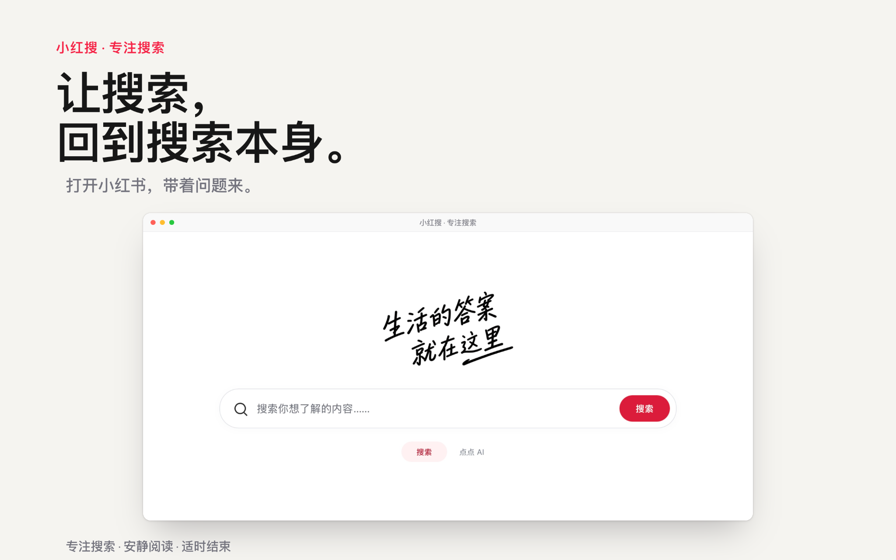

## 02 · 小窗模式

**少占屏幕，多一点专注。**

小窗与标准窗口共用同一个网页，切换时继续当前搜索和阅读。

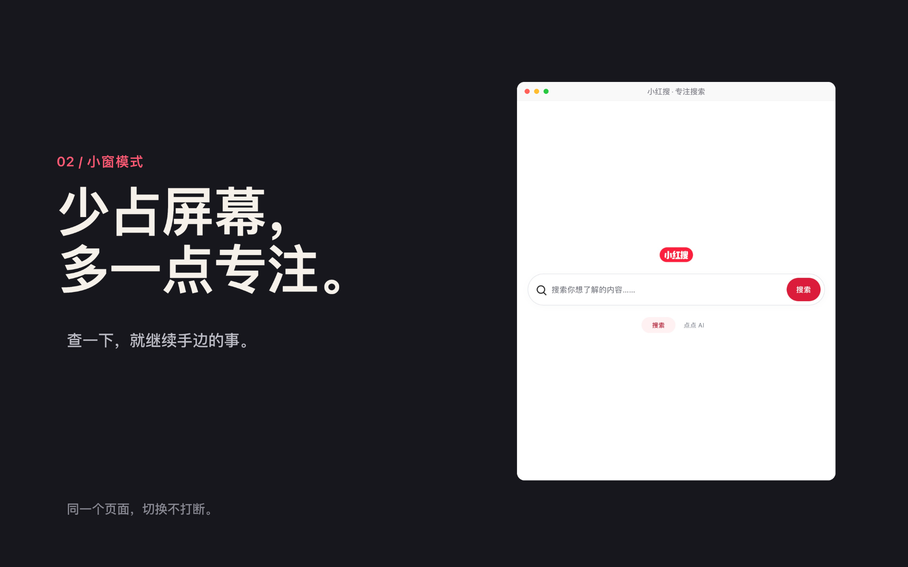

## 03 · 专注阅读

**读完了，就结束。**

在笔记底部结束本次搜索，回到专注首页，继续自己的工作。

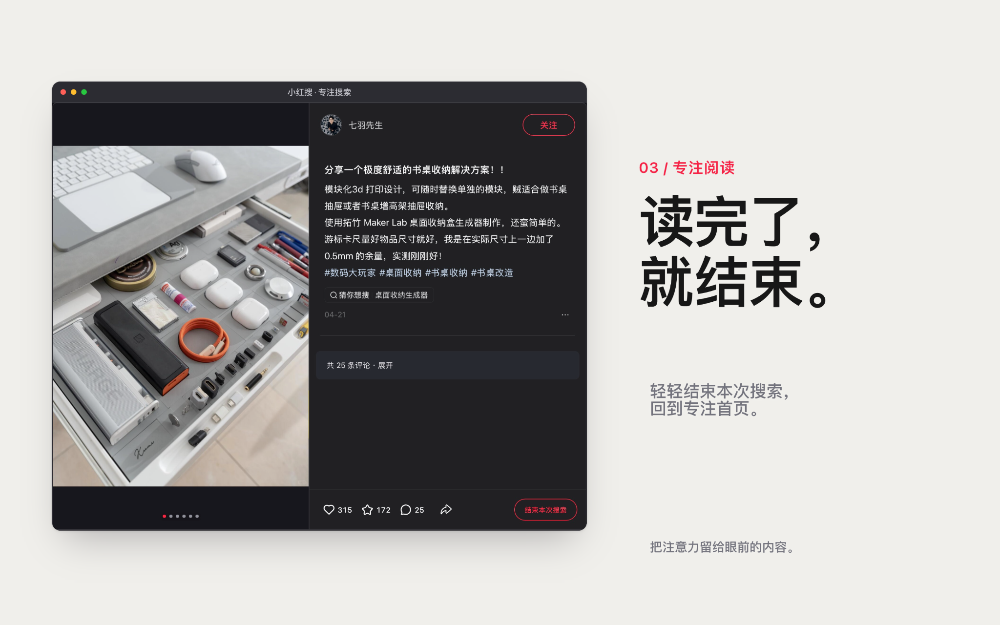

## 04 · 自由掌握

**专注到什么程度，由你决定。**

轻度、适中、深度三档干预，按自己的使用方式选择。

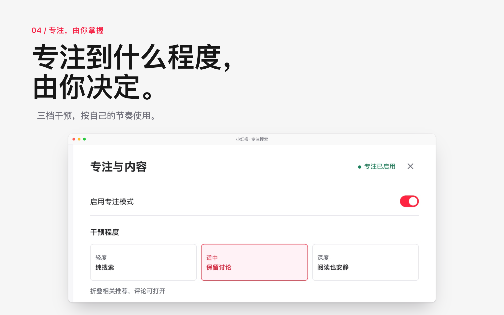

## 05 · 官方排序与筛选

**筛得更准，找得更快。**

保留小红书原有的排序和筛选，按内容类型、时间等条件缩小范围。

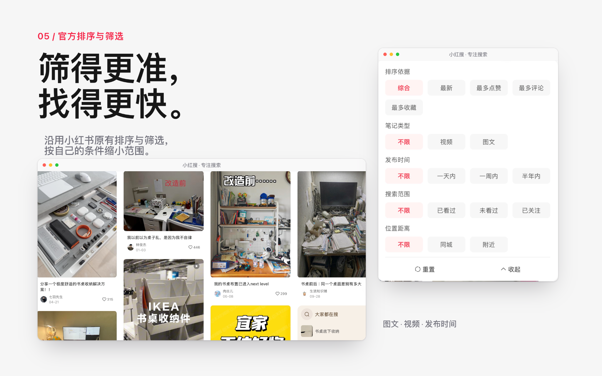

## 06 · 点点 AI

**想多问一句，就问点点。**

从搜索入口转到小红书官方点点 AI，在原有对话里继续追问。

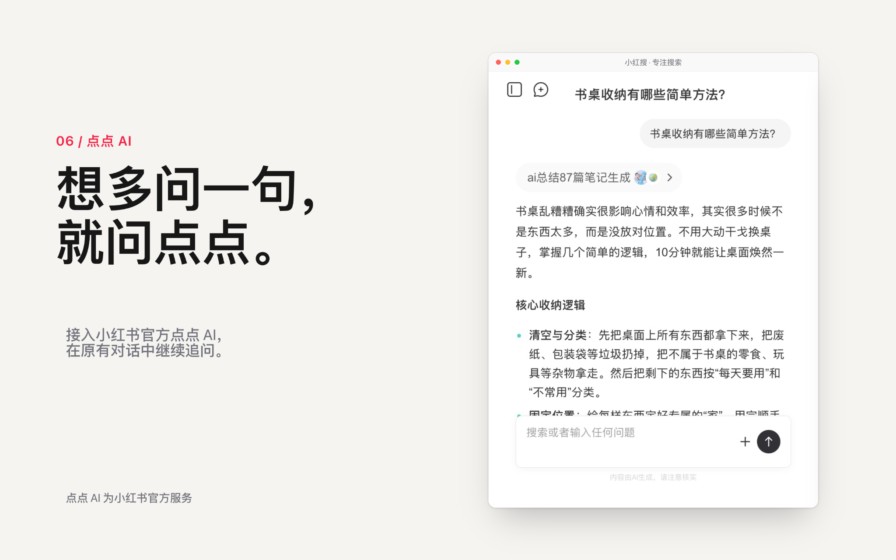

## 07 · 笔记内查找

**长笔记里，找到关键一句。**

使用 `Command + F` 查找当前页面文字，用关键词定位笔记中的内容。

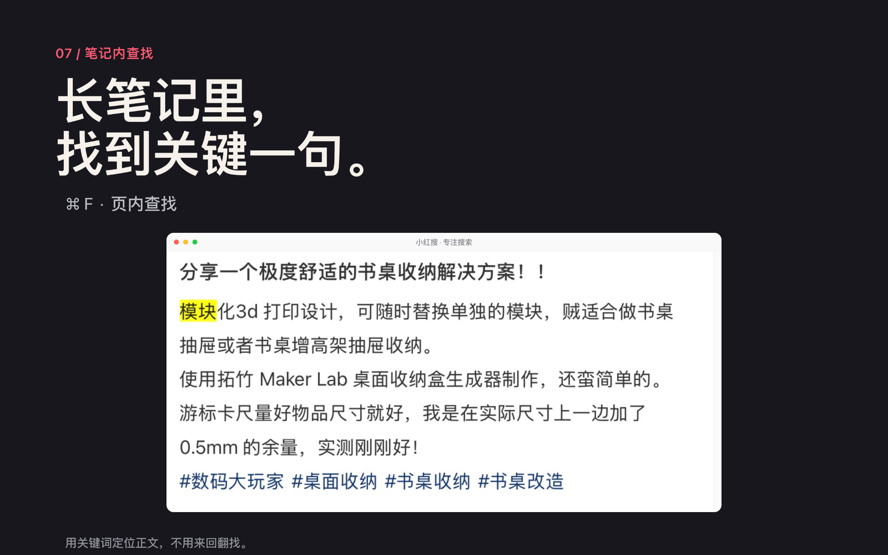

## 08 · 阅读提醒

**看得久了，轻轻提醒你。**

提醒默认关闭，可按需开启。只累计前台活跃阅读，按时长或连续下滑轻提醒。

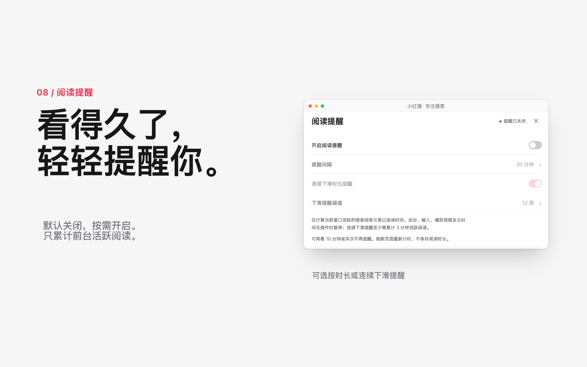

## 09 · 阅读字号

**文字大小，读着舒服就好。**

正文提供小、中、大字号，阅读主题可跟随小红书或自行选择。

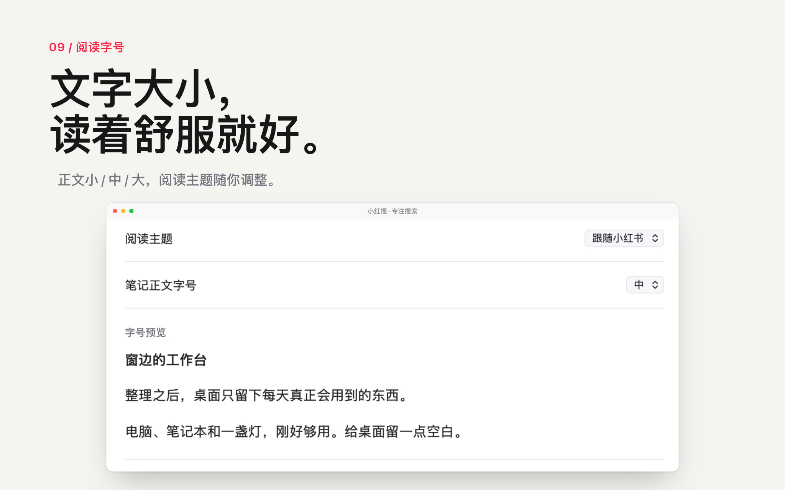

## 10 · 阅读主题

**浅色、深色，都读得舒服。**

浅色、深色或跟随小红书，按当前环境选择舒服的阅读明暗。

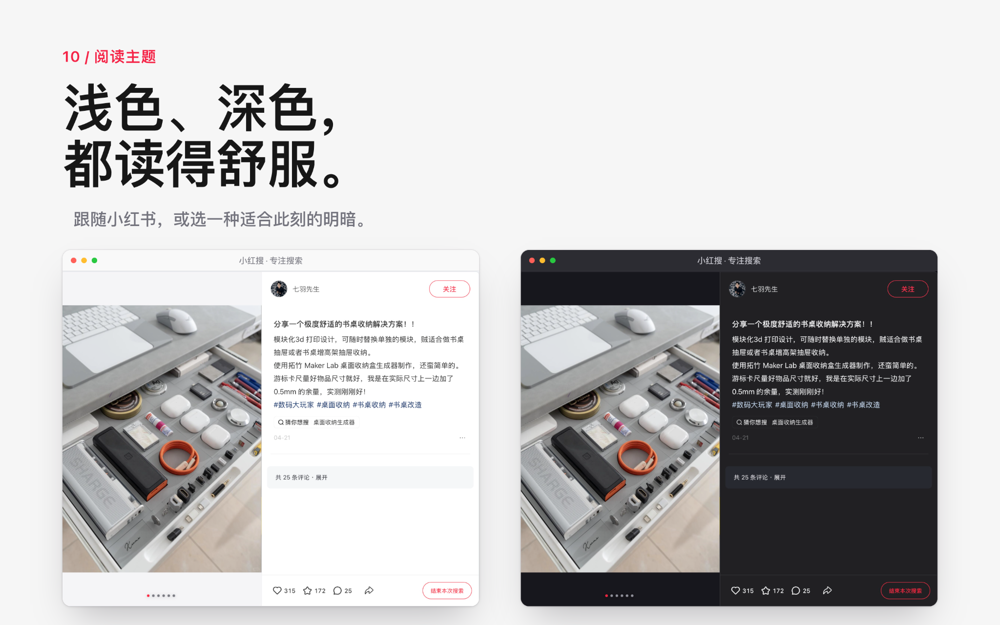

## 11 · 按需展开评论

**评论，想看时再打开。**

阅读正文时保持评论收起；想看讨论，再点击展开。

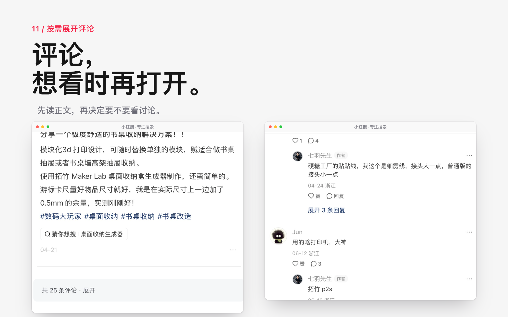

## 12 · 窗口偏好

**小窗怎么用，按习惯来。**

记住窗口尺寸与位置，置顶按需开启；最小化或隐藏时，可暂停视频。

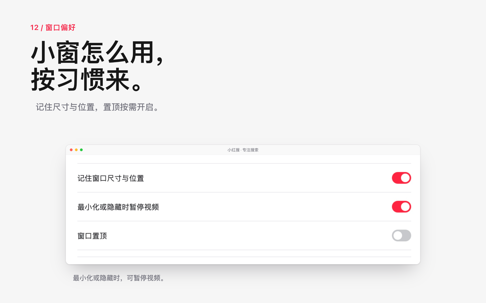

## 图片说明

产品图使用当前版本及此前实测界面的局部截图，加入宣传标题、窗口装饰和投影；没有重绘截图内的界面文字。实际界面以当前发行版与小红书原站为准。

点点 AI 是小红书提供的服务。公开笔记仅用于展示阅读界面，内容权利归原作者及相关权利人，不代表其推荐或背书。小红搜是独立开发的非官方应用。

图集中的十二张 PNG 为 2048×1280；高清包按五个尺寸整理，共 60 张 PNG。素材使用范围见 [版权说明](../NOTICE.txt)。
